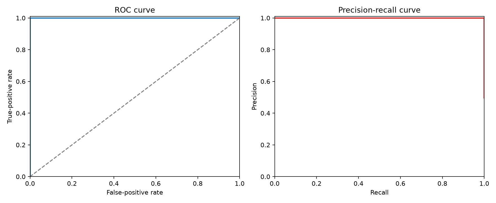

# AI Malware Detection from Memory Artifacts

An end-to-end machine-learning pipeline for classifying Windows memory samples as **benign** or **malware** using the [CIC-MalMem-2022 dataset](https://www.unb.ca/cic/datasets/malmem-2022.html). The repository covers data cleaning, exploratory analysis, leakage-aware feature engineering, model selection, threshold evaluation, robustness checks, and reproducible reporting.

> [!IMPORTANT]
> This is a research and educational project, not a production malware scanner. The final model achieves a perfect score on this repository's random held-out split, but related captures or malware families may occur across partitions. Validate on family-separated, time-separated, and independently collected data before considering operational use.

## Highlights

- Cleans and audits the raw memory-analysis dataset without modifying the source file.
- Removes the `Category` field to prevent target leakage and splits data before target-aware feature selection.
- Engineers 25 domain ratios, prunes highly correlated predictors, and retains the 25 strongest features.
- Compares logistic regression, random forest, Extra Trees, and histogram gradient boosting with stratified cross-validation.
- Selects models using validation F2, emphasizing malware recall while still penalizing false positives.
- Tunes the decision threshold on validation data and evaluates once on an untouched test set.
- Records hashes, software versions, metrics, plots, and serialized model metadata for reproducibility.

## Results

The selected **Extra Trees** pipeline was refitted on 46,421 training and validation rows, then evaluated on 11,606 held-out rows.

| Metric | Test result |
| --- | ---: |
| Accuracy | 1.0000 |
| Precision | 1.0000 |
| Malware recall | 1.0000 |
| F1 | 1.0000 |
| F2 | 1.0000 |
| ROC-AUC | 1.0000 |
| False positives / false negatives | 0 / 0 |

The weakest synthetic robustness scenario—10% Gaussian noise—retained an F2 score of 0.99969. These results describe this benchmark and its split; they do not measure performance under real-world dataset shift.



Detailed evidence is available in the [model-training report](reports/model_training/model_selection_training_report.md) and [evaluation report](reports/model_evaluation/model_evaluation_tuning_report.md).

## Pipeline

| Stage | Command | Main outputs |
| --- | --- | --- |
| 1. Clean and audit | `python scripts/clean_data.py` | `data/cleansed_data.csv`, cleaning audit |
| 2. Explore | `python scripts/eda.py` | EDA report, tables, and figures |
| 3. Engineer and select features | `python scripts/feature_engineering.py` | Train/validation/test splits and selection report |
| 4. Select and train model | `python scripts/model_selection_training.py` | Model comparison and trained bundle |
| 5. Tune and evaluate | `python scripts/model_evaluation_tuning.py` | Final bundle, metrics, confidence intervals, and robustness plots |

All commands are intended to run from the repository root. Randomized stages use `random_state=42`, and generated summaries record SHA-256 hashes of their inputs.

## Quick start

### Requirements

- Python 3.12 is recommended; the checked-in artifacts were produced with Python 3.12.7.
- Approximately 1 GB of free disk space is recommended for the environment and generated files.

Create an isolated environment and install the pinned dependencies:

```bash
git clone <your-repository-url>
cd AI-Security-Project

python3.12 -m venv .venv
source .venv/bin/activate
python -m pip install --upgrade pip
python -m pip install -r requirements.txt
```

Run the complete pipeline:

```bash
python scripts/clean_data.py
python scripts/eda.py
python scripts/feature_engineering.py
python scripts/model_selection_training.py
python scripts/model_evaluation_tuning.py
```

The repository includes the dataset, processed splits, reports, and trained artifacts, so you can also inspect the results without rerunning the computational stages.

## Using the trained model

The tuned Joblib bundle contains the fitted scikit-learn pipeline, ordered feature names, class labels, threshold, and training metadata. This example scores the checked-in test split:

```python
import joblib
import pandas as pd

bundle = joblib.load("models/malware_detector_tuned.joblib")
test = pd.read_csv("data/processed/test_selected.csv.gz")

features = test[bundle["feature_names"]]
malware_probability = bundle["model"].predict_proba(features)[:, 1]
prediction = (malware_probability >= bundle["decision_threshold"]).astype("int8")

print(pd.Series(prediction).map(bundle["class_labels"]).value_counts())
```

Only load Joblib files from sources you trust: serialized Python objects can execute code during deserialization. Raw CIC-MalMem rows must first receive the same cleaning and feature-engineering transformations used by this project; the final bundle expects the 25 selected columns.

## Repository structure

```text
.
├── assignment_report/     # Coursework report, notebook, figures, and source assets
├── data/
│   ├── Obfuscated-MalMem2022.csv
│   ├── cleansed_data.csv
│   └── processed/         # Selected train, validation, and test splits
├── models/                # Serialized model bundles
├── reports/
│   ├── eda/
│   ├── feature_engineering/
│   ├── model_training/
│   └── model_evaluation/
├── scripts/               # Reproducible pipeline stages
└── requirements.txt       # Pinned runtime dependencies
```

## Dataset and labels

The raw data is the University of New Brunswick Canadian Institute for Cybersecurity's CIC-MalMem-2022 memory-analysis dataset. Please follow the dataset publisher's citation and redistribution requirements when reusing it.

After cleaning:

- `Class = 0` means benign.
- `Class = 1` means malware.
- `Category` is removed because it can reveal family/sample information and leak the prediction target.
- Constant columns and duplicate rows are removed.

The repository currently stores the source dataset directly because every file is below GitHub's 100 MB individual-file limit. If the data grows, migrate large artifacts to Git LFS or an external data registry.

## Reports and reproducibility

- [Cleaning audit](reports/data_cleaning_audit.json)
- [EDA report](reports/eda/eda_report.md)
- [Feature-selection report](reports/feature_engineering/feature_selection_report.md)
- [Model-selection report](reports/model_training/model_selection_training_report.md)
- [Final evaluation report](reports/model_evaluation/model_evaluation_tuning_report.md)
- [Assignment report](assignment_report/Assignment_1_AI_Malware_Detection_Report.pdf)

Generated JSON summaries are machine-readable, while CSV tables and PNG figures preserve the supporting evidence. GitHub Actions checks dependency installation, Python syntax, and JSON validity on pushes and pull requests.

## Responsible use

Use this project only with systems and data you are authorized to analyze. Treat predictions as decision support, not proof that a machine is safe or compromised. Before deployment, evaluate new capture sources, malware families, temporal drift, adversarial manipulation, calibration, inference latency, and an escalation process for false positives and false negatives.

## License

The project code is available under the [MIT License](LICENSE). The CIC-MalMem-2022 dataset and other third-party materials are governed separately by their respective publishers' terms and citation requirements.
