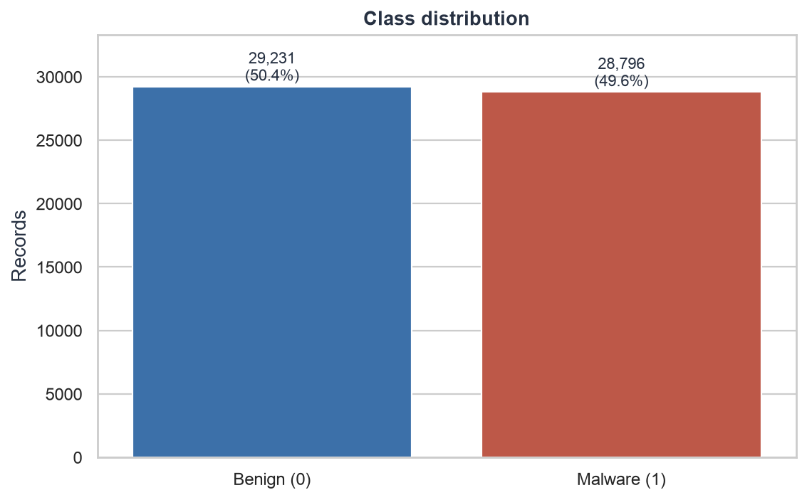
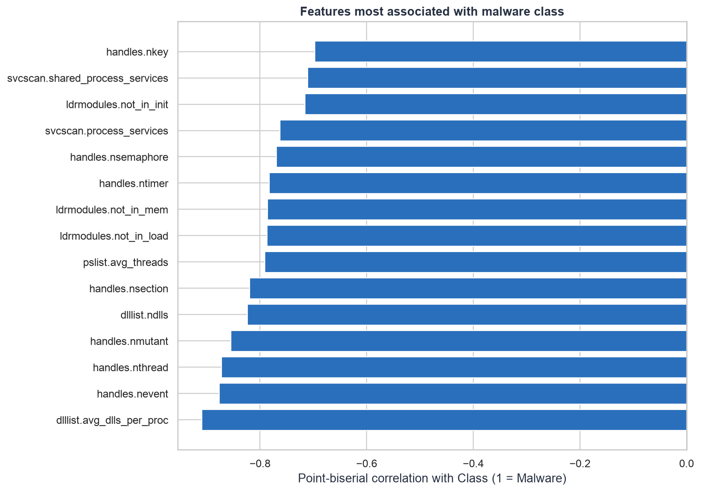
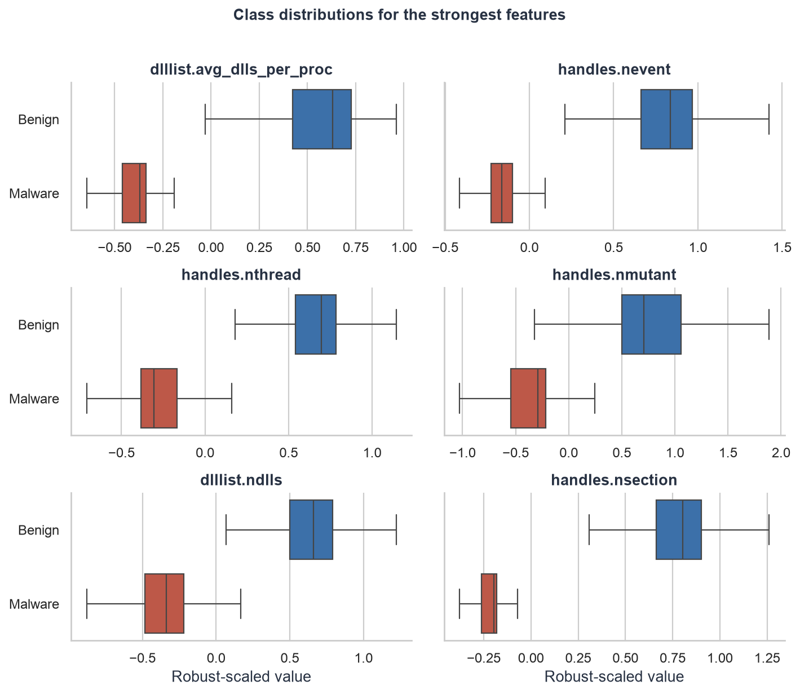
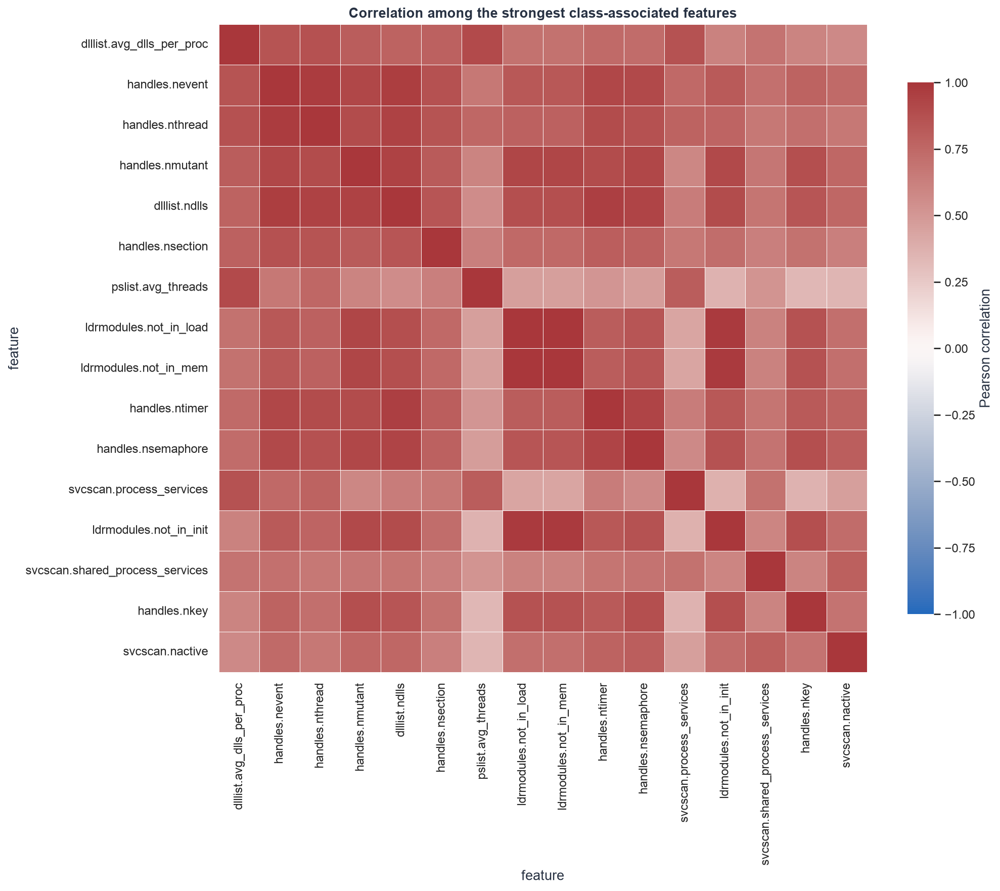
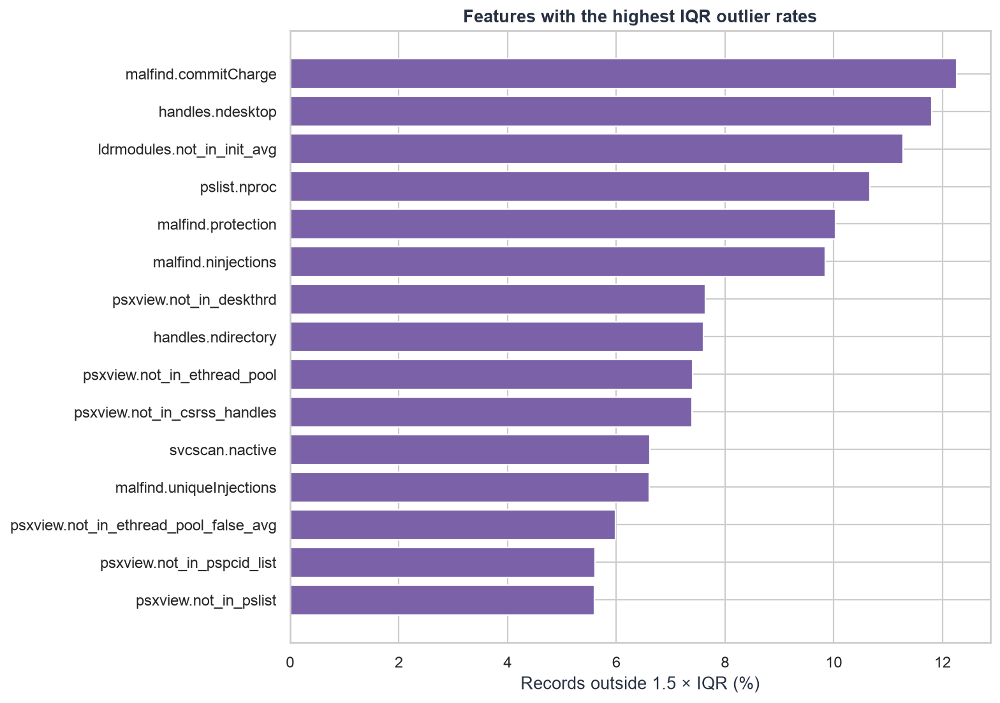
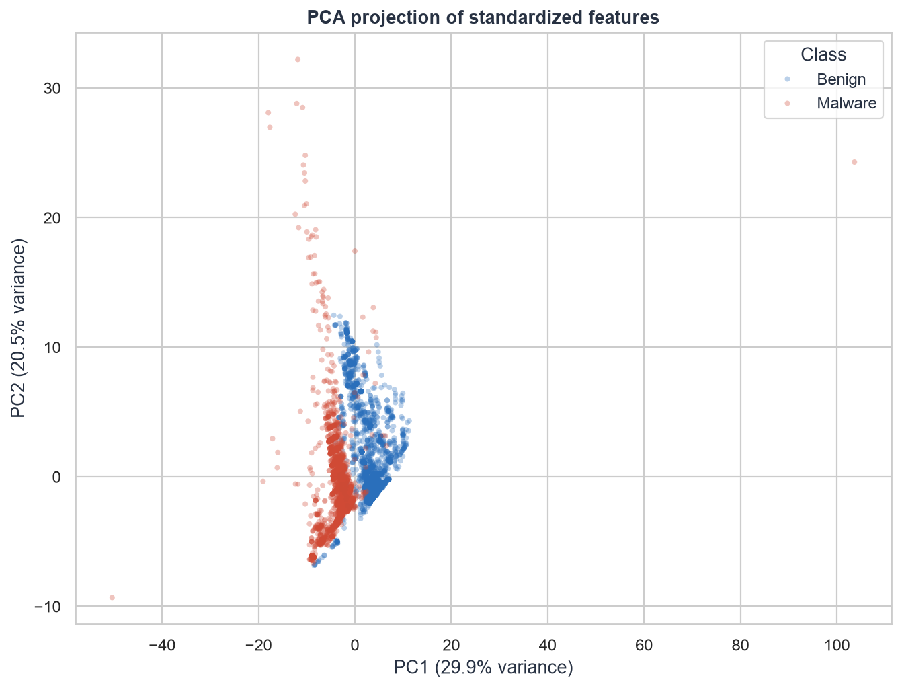

# Exploratory Data Analysis: Cleansed CIC-MalMem-2022 Data

## Executive summary

- The cleansed dataset contains **58,027 records**, **52 numeric features**, and one binary target. There are **0 missing cells**, **0 duplicate rows**, and no non-finite numeric values.
- The classes are nearly balanced: **29,231 benign (50.4%)** and **28,796 malware (49.6%)**. Class weighting is unlikely to be essential for the first baseline, but stratified splitting remains appropriate.
- The strongest univariate class associations are `dlllist.avg_dlls_per_proc` (r = -0.909, direction-adjusted AUC = 0.998, higher in benign), `handles.nevent` (r = -0.876, direction-adjusted AUC = 0.989, higher in benign), `handles.nthread` (r = -0.872, direction-adjusted AUC = 0.989, higher in benign), `handles.nmutant` (r = -0.854, direction-adjusted AUC = 0.988, higher in benign), `dlllist.ndlls` (r = -0.823, direction-adjusted AUC = 0.977, higher in benign). These features are useful candidates for baseline modeling, but the results do not establish causal importance.
- The best single-feature ranking is unusually strong. Treat this as a reason to test for collection artifacts and related samples across data splits, not as proof that deployment performance will be equally high.
- **57 feature pairs** have an absolute Pearson correlation of at least 0.90. This indicates substantial redundancy and supports testing regularization, correlation-based pruning, or tree-based models.
- The first two principal components explain **50.5%** of standardized feature variance. The 2-D projection is exploratory and should not be treated as a measure of final classification performance.
- IQR rules flag the highest apparent outlier rates in `malfind.commitCharge` (12.3%), `handles.ndesktop` (11.8%), `ldrmodules.not_in_init_avg` (11.3%), `pslist.nproc` (10.7%), `malfind.protection` (10.0%). In cybersecurity telemetry, extreme values may carry attack signal, so they should not be removed automatically.

## Dataset structure and quality

| Check | Result |
| --- | ---: |
| Rows | 58,027 |
| Predictive features | 52 |
| Integer features | 37 |
| Floating-point features | 15 |
| Missing cells | 0 |
| Infinite numeric cells | 0 |
| Exact duplicate rows | 0 |

The cleaning audit maps `Class = 0` to benign and `Class = 1` to malware. It also records removal of leakage (`Category`), constant features, and duplicates. Scaling remains deferred until after the train/test split.



## Class relationships

The table ranks features by absolute point-biserial correlation with the binary target. Direction-adjusted AUC describes the best one-feature ranking direction and is not a cross-validated model score.

| feature | point_biserial_correlation | standardized_mean_difference | direction_adjusted_auc | higher_in |
| --- | --- | --- | --- | --- |
| dlllist.avg_dlls_per_proc | -0.909 | -4.355 | 0.998 | Benign |
| handles.nevent | -0.876 | -3.639 | 0.989 | Benign |
| handles.nthread | -0.872 | -3.562 | 0.989 | Benign |
| handles.nmutant | -0.854 | -3.290 | 0.988 | Benign |
| dlllist.ndlls | -0.823 | -2.901 | 0.977 | Benign |
| handles.nsection | -0.820 | -2.863 | 0.989 | Benign |
| pslist.avg_threads | -0.791 | -2.585 | 0.962 | Benign |
| ldrmodules.not_in_load | -0.786 | -2.546 | 0.976 | Benign |
| ldrmodules.not_in_mem | -0.786 | -2.546 | 0.976 | Benign |
| handles.ntimer | -0.783 | -2.518 | 0.979 | Benign |





## Feature relationships and redundancy

The strongest feature-to-feature relationships are shown below. Highly correlated variables can make linear coefficients unstable and may duplicate signal.

| feature_1 | feature_2 | correlation | absolute_correlation |
| --- | --- | --- | --- |
| ldrmodules.not_in_load | ldrmodules.not_in_mem | 1.000 | 1.000 |
| psxview.not_in_pslist | psxview.not_in_session | 1.000 | 1.000 |
| ldrmodules.not_in_load_avg | ldrmodules.not_in_mem_avg | 1.000 | 1.000 |
| malfind.ninjections | malfind.protection | 1.000 | 1.000 |
| psxview.not_in_ethread_pool | psxview.not_in_csrss_handles | 1.000 | 1.000 |
| psxview.not_in_pslist_false_avg | psxview.not_in_session_false_avg | 0.994 | 0.994 |
| pslist.avg_handlers | handles.avg_handles_per_proc | 0.993 | 0.993 |
| psxview.not_in_pslist | psxview.not_in_pspcid_list | 0.992 | 0.992 |
| psxview.not_in_pspcid_list | psxview.not_in_session | 0.992 | 0.992 |
| psxview.not_in_pslist_false_avg | psxview.not_in_pspcid_list_false_avg | 0.988 | 0.988 |



## Distribution shape and outliers

The IQR outlier rate is a diagnostic, not a deletion rule. Review extreme values against domain expectations and fit any clipping or transformation using training data only.

| feature | skewness | zero_rate | iqr_outlier_rate |
| --- | --- | --- | --- |
| malfind.commitCharge | 14.175 | 0.000 | 0.123 |
| handles.ndesktop | 1.296 | 0.000 | 0.118 |
| ldrmodules.not_in_init_avg | 20.636 | 0.000 | 0.113 |
| pslist.nproc | 7.093 | 0.000 | 0.107 |
| malfind.protection | 11.282 | 0.000 | 0.100 |



## Multivariate structure

PCA was fitted to standardized features for visualization. PC1 explains **29.9%** and PC2 explains **20.5%** of the variance.



## Modeling implications

1. Use a stratified train/validation/test split and fit scaling, imputation safeguards, feature selection, and any outlier handling on training data only.
2. Start with an interpretable regularized logistic-regression baseline, then compare tree ensembles that can capture nonlinear interactions.
3. Evaluate correlation pruning or regularization because the dataset contains strongly redundant feature groups.
4. Report precision, recall, F1, ROC-AUC, and the confusion matrix. For malware detection, choose the operating threshold according to the cost of false negatives and false positives.
5. Check split strategy against collection or malware-family grouping if those identifiers are available outside this leakage-safe table. Random row splits can overstate generalization when closely related samples occur across folds.
6. Investigate the near-perfect one-feature AUC before trusting benchmark scores. Validate on a time-separated, family-separated, or independently collected test set when possible.

## Reproducibility

- Input: `data/cleansed_data.csv`
- Cleaning audit: `reports/data_cleaning_audit.json`
- Script: `scripts/eda.py`
- Random seed: 42
- Source SHA-256: `f5e81dc47faa0d5204091582155f9f7692a6f9ddbea7da70b25ae4d1b3a3bfbd`
- Cleaning audit source rows: 58596

Run from the project root:

```bash
.venv/bin/python scripts/eda.py
```
